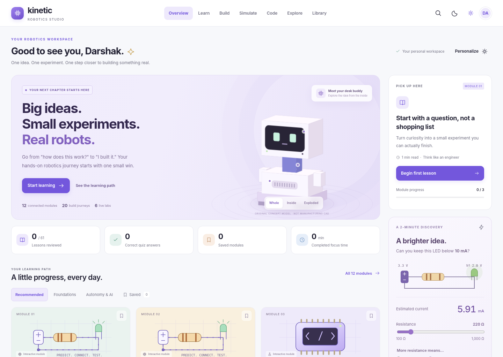

# Kinetic Robotics Studio

Interactive robotics learning platform with lessons, staged projects, numerical
experiments, editable code, a hardware gallery, and curated simulator resources.



## Dashboard redesign

A personalized overview, searchable module catalog, saved-course queue, live circuit
challenge, practice timer and module evidence notebooks are included. Existing lessons,
projects and labs remain available. [Implementation and deployment guide](docs/dashboard-redesign.md).

[Validation results and environment limitations](docs/dashboard-validation.json).

## Quick start (Ubuntu / Linux / macOS)

```bash
python3 serve.py
```

Then visit the local URL printed by the server (`http://127.0.0.1:8765/` by default).
No package install is required to browse the website.

## Source layout

```text
.github/workflows/pages.yml    CI checks and GitHub Pages deployment
src/                            App, dashboard views/styles, lessons and engines
assets/                         Original locally bundled MP4 demonstrations
native-labs/                    ROS, MCU, Python and model examples
scripts/check_site.py           Release smoke check
scripts/publish_local.sh        Build and verify a deployable `dist/` folder
tests/                          Unit and optional browser tests
build.py                        Generate the standalone website
serve.py                        Run a local server
index.html                      Prebuilt local entry page
docs/preview.png                Project screenshot
```

### Build after edits

```bash
python3 build.py
python3 serve.py
```

To generate the exact folder that CI publishes:

```bash
bash scripts/publish_local.sh
python3 -m http.server --directory dist 8000
```

Open http://localhost:8000/ . The `dist/` folder is generated, not committed.

### Test

```bash
node --test tests/*.test.js
python3 scripts/check_site.py
```

GitHub Actions also checks syntax and model XML and deploys the generated output.

## Publish publicly via GitHub Pages

1. Create a **public repository** (suggested: `kinetic-robotics-studio`).
2. Upload this repository's **contents** or use `git init` + `git push` to `main`.
3. Go to **Settings > Pages > Build and deployment > Source: GitHub Actions**.
4. Open **Actions**, check **Test and deploy GitHub Pages** succeeded.
5. Visit `https://darshak1just.github.io/kinetic-robotics-studio/`.

Future pushes to `main` rebuild and publish. Pull requests run verification only.

### Push from Ubuntu

```bash
git init
git add .
git commit -m "Initial Kinetic Robotics Studio website"
git branch -M main
git remote add origin https://github.com/YOUR_USERNAME/kinetic-robotics-studio.git
git push -u origin main
```

Replace `YOUR_USERNAME` with your actual account. Git authentication is required.
If Git requests identity configuration, run `git config --global user.name` and
`git config --global user.email` with your own values.

## Site capabilities and limitations

- Main app is static and runs on GitHub Pages without a paid hosting service.
- Built-in demos, lessons, and JS experiments work in browser; GPU simulators do not
  run on GitHub Pages servers.
- User progress is stored in **local browser storage** (not synchronized accounts).
- Many real hardware images and external videos are **remote references**, not
  included offline; links/embedding can fail due to source policy or network issues.
- The bundled MP4 demonstrations are original teaching clips, not live Gazebo/Isaac recordings.
- This repo does **not** include a server-side API, database, or secret keys.
- Verify permission before downloading or redistributing third-party images or videos.
- Review licensing notes before commercial use or public contributions.

## Useful configuration

Repository name changes will change the GitHub Pages URL. Because this is a
self-contained generated index, the site does not rely on root-relative asset paths.
See `THIRD_PARTY_NOTICES.md` and `LICENSE-CHOICE.md`.
